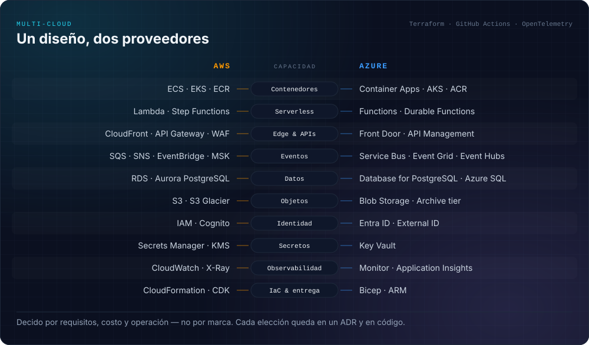

<div align="center">



<br/>

<a href="https://www.linkedin.com/in/sebastian-guarnizo-campos/"></a> <a href="mailto:sebstiangc555@gmail.com"></a>

</div>

<br/>

```yaml
apiVersion: people/v1
kind: Engineer
metadata:
  name: sebastian-guarnizo-campos
  location: Bogotá, Colombia
spec:
  roles: [software-architect, cloud-architect, senior-software-engineer]
  clouds: [aws, azure]
  styles: [monolith, modular-monolith, hybrid, microservices]
  designs: [event-driven, hexagonal, multi-tenant, local-first]
  ships: [web, desktop, mobile]
  documents: every-decision   # ADRs, no folclore
status:
  phase: Building
```

Diseño y construyo plataformas de punta a punta: desde el dominio y los límites entre servicios hasta la infraestructura, la observabilidad y el instalador que llega al usuario. Me importa que un sistema **escale, se pueda auditar y siga siendo mantenible dentro de cinco años**, no solo que pase la demo.

<table>
<tr>
<td width="33%" valign="top">

**◆ Arquitectura de software**

Monolitos, monolitos modulares, arquitecturas híbridas y microservicios: elijo según el problema. Hexagonal, eventos con Kafka y NATS, migraciones con *strangler fig* y decisiones registradas en ADRs.

</td>
<td width="33%" valign="top">

**◆ Arquitectura cloud**

Diseño sobre AWS y Azure: contenedores y Kubernetes, edge y gateways, mensajería gestionada, identidad, secretos, observabilidad e infraestructura como código.

</td>
<td width="33%" valign="top">

**◆ Ingeniería senior**

Java 21 / Spring Boot, Angular, Python / FastAPI, Electron y Capacitor. CI/CD con GitHub Actions, pruebas automatizadas y agentes de IA en el ciclo de desarrollo.

</td>
</tr>
</table>

<br/>

### Productos que he lanzado

Aplicaciones reales, con instalador y actualización automática. El código es privado; las descargas y las notas de versión son públicas.

| Producto | Qué hace |
|---|---|
| **[Laplace](https://github.com/sebastian0912/Laplace-releases)** | Gestión de proyectos con Scrum y Kanban, con visita guiada y temas accesibles. |
| **[Scripta](https://github.com/sebastian0912/Scripta-releases)** | Verificación de antecedentes por encargo: carga la lista, consulta fuentes oficiales y entrega un reporte con evidencias. El motor de consulta se instala aparte, bajo demanda. |
| **[Tend](https://github.com/sebastian0912/tend-releases)** | Hábitos y finanzas personales, *local-first*: los datos viven en tu equipo. |
| **[Turnero](https://github.com/sebastian0912/Turnero)** | Turnos, desprendibles, contratación y auditoría para la atención en sede de una empresa de talento humano. |
| **[Formularios Robots](https://github.com/sebastian0912/Formulario-robots-migracion)** | Consulta automatizada de antecedentes en Policía, Procuraduría, Contraloría, OFAC y otras fuentes, con informe unificado en PDF. |

### Experiencia reciente

- **Vigías de Colombia** · Arquitecto de software y líder técnico (equipo de 7). Plataforma escritorio/web/móvil con visión artificial en tiempo real (NVIDIA DeepStream, YOLOX), Java 21 / Spring Boot, PostgreSQL + pgvector y push-to-talk con LiveKit.
- **Fiduprevisora** · Líder técnico de desarrollo. Arquitectura de microservicios, hexagonal y DDD; CI/CD en Azure; ADRs, code review y mentoring a 12 desarrolladores.
- **BIT 512** · Desarrollador full stack en el nuevo sistema del INVIMA: 12 funcionalidades en producción y −60 % en tiempos de respuesta.

<br/>



<br/><br/>



<br/><br/>



<br/><br/>


<div align="center">
<sub>Los diagramas de este perfil son código (<code>scripts/build_assets.py</code>) y la telemetría se renueva cada día con GitHub Actions (<code>scripts/telemetry.py</code>).</sub>
</div>
